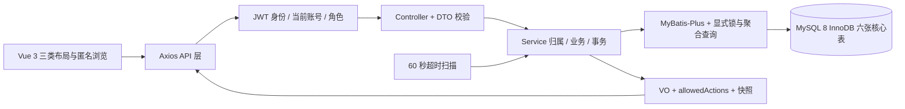

# 系统架构方案

基线：根目录《蛋糕店订单管理系统需求说明书_V1.1.docx》，实际修订日期 2026-11-24；叠加用户当日明确确认的环境变更 ENV-01：Node.js 使用 24.20.0，覆盖原文 Node 18 的执行要求，原始 DOCX 保持不变。本文是 Phase 0 的设计方案，未建立工程、安装依赖、创建数据库或验证运行。需求原文与完整追踪分别见 [需求基线](../requirements/REQUIREMENTS_BASELINE.md) 和 [追踪矩阵](../requirements/TRACEABILITY_MATRIX.md)。

## 1. 架构目标与范围

采用一个 Spring Boot 后端、一个 Vue 单页前端和一个 MySQL 数据库的模块化单体，覆盖 USER、MERCH、PROD、ORDER、STAT 五模块。前端按 CUSTOMER、MERCHANT、ADMIN 分别提供用户布局、本店经营布局和平台管理布局；匿名访客可公开浏览。后端通过独立命名空间、角色检查和资源归属条件提供隔离。

不引入微服务、Redis、消息队列、真实支付、退款审批、外部物流、SKU、跨店合单、配送费、优惠券、资金结算或额外核心业务表。图片仅录入已有 `/images/` 路径或 http/https URL，不增加上传接口。令牌失效依靠 `sys_user.token_version`，下单幂等依靠订单唯一约束。

## 2. 技术版本与兼容性核验

核验日期为 2026-11-24。下表是基于官方文档、官方仓库版本元数据的**静态候选核验**，不是依赖解析、构建、启动、接口调试或安全审计通过结论。候选不是“最新版本”承诺；后续阶段须复核补丁、传递依赖和公开漏洞，并把最终精确版本记录在工程与锁文件中。

| 部件 | 候选与依据 | Phase 1 验证门禁 |
| --- | --- | --- |
| JDK / Maven | 需求固定 JDK 17；Spring Boot 3.5.16 官方最低 Java 17、Maven 3.6.3，候选 Maven 3.9.x，补丁待环境确认。[Spring Boot 系统要求](https://docs.spring.io/spring-boot/3.5/system-requirements.html) | 使用用户确认的 JDK 17；核对 `java -version`、`javac -version`、`mvn.cmd -version` 的实际路径和版本；不能因本机有 JDK 18 而宣称满足 17。 |
| Spring Boot / MVC / Security | Boot 3.5.16 候选，依其 BOM 管理 Spring Framework、Spring Security、Jackson、Validation、JUnit 等版本，使用 Jakarta 命名空间。[官方系统要求](https://docs.spring.io/spring-boot/3.5/system-requirements.html) | 基础启动、序列化、Bean Validation、异常处理、Security 过滤器及依赖树无冲突；不独立混用 Boot 2 的 javax 组件。 |
| MyBatis-Plus | `com.baomidou:mybatis-plus-spring-boot3-starter:3.5.18` 候选，符合 3.5.x；官方区分 Boot 2/3 starter。3.5.9 起部分插件依赖拆分，分页按同一版本系列加入 JSqlParser 模块。[官方安装说明](https://baomidou.com/getting-started/install/) | 不再并装 MyBatis 或 Boot 2 starter；验证 Mapper 扫描、分页、MySQL 方言、参数绑定、事务和锁查询；禁止仅靠通用 CRUD 实现库存竞争。 |
| MySQL / JDBC | 基线为 MySQL 8.x，当前勘察版本 8.0.19；连接器采用 Boot BOM 管理的 `com.mysql:mysql-connector-j` 候选版本，解析后记录。 | Phase 2 在单独授权的数据库校验驱动连接、InnoDB、字符集/排序规则、CHECK 实际执行、毫秒时间和完整外键索引；本轮未连接或建库。 |
| OpenAPI / Knife4j | `org.springdoc:springdoc-openapi-starter-webmvc-api:2.10.1` 加 `com.github.xiaoymin:knife4j-openapi3-ui:4.5.0` 为候选；Springdoc 官方矩阵将 Boot 3.5.x 对应 2.8.x～2.10.x；Knife4j 官方说明纯 UI 可与不同 Boot 版本配合。[Springdoc 矩阵](https://springdoc.org/v2/)、[Knife4j 版本说明](https://doc.xiaominfo.com/docs/quick-start/start-knife4j-version)、[纯 UI 官方 POM](https://raw.githubusercontent.com/xiaoymin/knife4j/v4.5.0/knife4j/knife4j-openapi3-ui/pom.xml) | 仅使用 OpenAPI3；验证 `/doc.html` 静态资源、`/v3/api-docs` 与分组配置、Bearer Authorize、参数/错误枚举、校验和异常处理；无运行验证前不宣称可调试。 |
| JWT / BCrypt | 候选采用 Boot 管理的 Spring Security JWT 编解码组件和 BCryptPasswordEncoder；JWT 协议与散列规则严格按需求 5.4，无另建令牌表。 | 固定算法白名单、随机外置密钥、验签/时效/数据库版本检查，BCrypt 工作因子至少 10；不在配置或日志中保留真实秘密。 |
| Node.js / npm | ENV-01 已确认使用 Node 24.20.0；当前实测 Node 24.20.0 / npm 11.19.0，Node 满足用户最新要求。Node 官方将 24 标为 LTS、18 标为 EOL；此处保留原文 18 仅作为变更来源。[Node 官方发布状态](https://nodejs.org/en/about/previous-releases)、[npm 官方元数据](https://raw.githubusercontent.com/npm/cli/v11.19.0/package.json) | 保留现有环境，不执行安装或版本切换；后续用 npm.cmd 并验证项目依赖在此 Node 下运行，原文版本差异已由用户决定，不再作为待确认阻断。 |
| Vite / Vue 插件 | Vite 7.2.2 与 `@vitejs/plugin-vue` 6.0.2 候选；两者 engines 均允许 Node 20.19 及以上的 20.x，或 Node 22.12 及以上版本，Node 24.20.0 满足；插件支持 Vite ^7 与 Vue ^3.2.25。[Vite 元数据](https://raw.githubusercontent.com/vitejs/vite/v7.2.2/packages/vite/package.json)、[插件元数据](https://raw.githubusercontent.com/vitejs/vite-plugin-vue/plugin-vue@6.0.2/packages/plugin-vue/package.json) | 固定具体版本，检查锁文件全依赖 engines，并在 Node 24.20.0 实际安装、测试和构建。禁止直接用 `create-vite@latest` 代替固定版本与兼容检查；当前仅静态核验。 |
| Vue / Router / Pinia | Vue 3.5.13、Vue Router 4.5.0、Pinia 2.3.1 为候选；Router 需 Vue ^3.2.0，Pinia 需 Vue ^3.5.11，与候选 Vue 相容。[Vue 元数据](https://raw.githubusercontent.com/vuejs/core/v3.5.13/packages/vue/package.json)、[Router 元数据](https://raw.githubusercontent.com/vuejs/router/v4.5.0/packages/router/package.json)、[Pinia 元数据](https://raw.githubusercontent.com/vuejs/pinia/v2.3.1/packages/pinia/package.json) | 核对 Vue 编译器与运行时同版本，验证路由、Store 和 SFC 构建；不使用 Vue 2 工程模板。 |
| Element Plus / Axios / ECharts | Element Plus 2.9.3（官方该 tag 的 peer 为 Vue ^3.2.0）、Axios 1.13.2、ECharts 5.6.0 为待锁定候选；后两者用于浏览器请求和图表。[Element Plus tag 元数据](https://raw.githubusercontent.com/element-plus/element-plus/2.9.3/packages/element-plus/package.json)、[Axios 元数据](https://raw.githubusercontent.com/axios/axios/v1.13.2/package.json)、[ECharts 元数据](https://raw.githubusercontent.com/apache/echarts/5.6.0/package.json) | 核对实际发布包版本、传递依赖 engines、安全补丁、浏览器产物；验证中文表单、响应拦截、图表 resize/dispose；元数据兼容不等于整套依赖已经安装成功。 |

**Knife4j 组合风险说明：**官方 4.5.0 Jakarta starter 的 POM 引用 Springdoc，其父 POM 固定 Springdoc 2.3.0；Springdoc 官方矩阵把 2.3.x～2.5.x 对应 Boot 3.2.x，因此不能把该旧 starter 直接与 Boot 3.5 候选拼装后宣称兼容。当前方案选纯 UI 与匹配的 Springdoc API 模块，避开旧服务端增强依赖。若后续需要增强 starter，须重新验证完整兼容关系，不可仅改一个版本号假定成立。[官方 starter POM](https://raw.githubusercontent.com/xiaoymin/knife4j/v4.5.0/knife4j/knife4j-openapi3-jakarta-spring-boot-starter/pom.xml)、[官方父 POM](https://raw.githubusercontent.com/xiaoymin/knife4j/v4.5.0/knife4j/pom.xml)。

前端选用 JavaScript SFC 候选，以减少课程工程的额外工具要求；若后续选 TypeScript，须同时复核编译器与类型检查工具在 Node 24.20.0 下的支持。前端单元测试和端到端测试工具同样须检查 engines。以上属于实现选项，最终依赖树和真实构建是 Phase 1 门禁。

## 3. 后端分层与职责

拟定根目录 `backend/`，包名前缀由 Phase 1 确认（候选 `com.cake.platform`）。以下路径均为规划，不表示已经创建。

| 层/目录 | 规划职责与边界 |
| --- | --- |
| `controller/auth`、`controller/user` | 登录注册、退出、本人资料、密码；只接收专用 DTO，不能直接绑定 Entity。 |
| `controller/publicapi` | 公开商家、分类和商品；统一可用店铺判定，不暴露停用店铺或后台商品。 |
| `controller/merchant` | 本店商品、分类、订单、接单及统计入口；角色严格为 MERCHANT，不能接受 merchantId 覆盖归属。 |
| `controller/admin` | 平台商家/用户管理、只读订单/统计；ADMIN 不能复用经营写入口。 |
| `service/user`、`service/merchant`、`service/product` | 身份、商家绑定、资料、分类商品、库存规则；平台创建账号与店铺在同事务。 |
| `service/order` | 下单、幂等、取消、支付、接单、履约、权限与 allowedActions；写服务通过独立事务入口组织，Controller 不控制库存。 |
| `service/statistics` | 参数验证、同店/平台范围、主表聚合、排行与补零；只读事务，不能修复或回写订单。 |
| `mapper`、`resources/mapper` | 六表持久化、显式 FOR UPDATE、条件更新、索引友好分页与聚合；只接收可信身份范围，所有值参数绑定。 |
| `entity` | 六张表逐字段映射，不增加 SKU 等实体表；不可把 Entity 直接序列化到接口。数据库 snake_case 与 Java lowerCamelCase 一致映射。 |
| `dto` | 各接口独立输入白名单，分页、QOrder、PEdit、OCreate、统计范围等可复用值对象；区分新增/编辑/库存/展示状态/订单动作，避免敏感字段混入。 |
| `vo` | User、Merchant、Category、Product、OrderSummary、OrderDetail、Sales、HotProducts；严格按需求 5.1.1，屏蔽密码、tokenVersion、requestHash 等内部值。 |
| `security` | JWT 签发/验签、当前账号状态和 token_version、数据库当前角色、商家绑定、角色匹配和认证上下文；退出与密码变更使账号全部旧令牌失效。 |
| `exception`、`common` | 统一 `{code,msg,data}`、HTTP 与业务码、fieldErrors、请求关联号及日志脱敏；不把所有异常转成 HTTP 200。 |
| `config` | Security、MyBatis-Plus 分页、Jackson ID/金额/时间、Validation、OpenAPI、CORS、数据库连接与调度；真实密码和密钥从外部注入。 |
| `scheduled` | 每 60 秒扫描已到期 status=0；按订单调用与支付共用的取消事务能力；无公开强制触发接口。 |
| `src/test` | 按模块提供业务单测、权限/API 集成、MySQL 事务并发与故障回滚测试；不能用内存库通过替代 InnoDB 并发证据。 |

请求校验按“已验证身份→数据库当前状态及角色→资源归属→输入/业务状态→事务动作”组织。非法敏感字段返回 40302；未知普通字段或 Query 参数返回 40001。需要在 Security、参数解析和异常处理衔接处测试，避免默认框架行为悄悄忽略字段。

## 4. 六表与数据边界

| 表 | 设计职责与关键约束 |
| --- | --- |
| `sys_user` | ADMIN、MERCHANT、CUSTOMER 共表；username/phone 唯一，BCrypt，status、token_version、login_fail_count、locked_until；仅 CUSTOMER 公开注册。 |
| `cake_merchant` | user_id 唯一绑定 MERCHANT；一店一号且不换绑；店铺启停与账号禁用是不同概念。 |
| `cake_category` | merchant_id 非空；`UK(merchant_id,name)` 本店同名保护，`UK(id,merchant_id)` 支持复合外键。 |
| `cake_product` | merchant_id/category_id 非空，分类必须同店；独立商品 ID 代表具体规格，DECIMAL(10,2) 单价、INT 非负库存。 |
| `cake_order` | CUSTOMER user_id 与唯一 merchant_id；订单号唯一、`UK(user_id,request_id)`；request_hash、商家名称/联系快照、金额、类型、状态、独立事件时间。 |
| `cake_order_item` | 订单和商品引用，`UK(order_id,product_id)`；商品名称/规格/单价/数量/小计快照。应用事务验证明细与主订单同店。 |

完整字段、默认值、可空、键与索引直接以需求 4.3～4.5 和需求基线为准，不在方案中另造结构。所有外键 RESTRICT，无级联删除；历史引用商品仅下架，店铺/账号/订单不物理删除。普通索引必须保留原文列顺序，不能在 Phase 2 擅自“简化”。字符集/排序规则尚需确认，因其决定本店分类名唯一性的比较语义。

ID 以正十进制字符串在 JSON/Path 传输，避免浏览器 Number 精度丢失。数据库 BIGINT UNSIGNED 的全范围超过 Java signed long 上限，候选采用 BigInteger 和明确的 JDBC/MyBatis 映射覆盖完整范围，Phase 2 验证自增键回填与关联字段边界；不得默默改数据库字段。金额使用 BigDecimal，禁止 double/float，输入不超过两位小数，输出固定两位字符串；单行和总额超过 DECIMAL(10,2) 上限须拒绝而非舍入。

事件时间使用数据库 `CURRENT_TIMESTAMP(3)`，Asia/Shanghai 解释、DATETIME(3) 保存，API 输出 ISO 8601 毫秒及 +08:00。创建取同一个数据库时间计算 expire_time；update_time 不代替业务事件。历史展示读取商家、商品、联系快照，不能因当前资料改名而重写历史。

## 5. 权限与认证设计

JWT 含 sub、role、ver、iat、exp，有效期 2 小时；固定算法白名单。若采用 HS256，至少 32 字节随机密钥外置。每个受保护请求都检查签名、有效期、数据库账号启停、token_version、数据库当前角色；商家绑定从 cake_merchant 读取，不能信任客户端或 JWT 自报 merchantId。

公开注册只允许 CUSTOMER；ADMIN 由后续受控初始化创建；MERCHANT 由 API-36 同事务创建账号与店铺。连续错误 5 次锁 10 分钟，失败计数更新须并发安全；锁定截止之后首个重试先开始新一轮计数，成功清零。退出/改密原子递增版本，平台启停 CUSTOMER 时状态和版本一起更新。用户名、手机号、角色不可通过本人资料修改。

| 入口范围 | 后端强制规则 |
| --- | --- |
| 公开 `/api/merchants`、`/api/products`、`/api/categories` | 仅可用店铺（店铺和商家账号均启用）及启用分类/上架商品，售罄仍展示；非可用店铺详情 40404。 |
| 顾客订单 `/api/orders` | 仅 CUSTOMER，user_id 从当前身份取得；其他顾客订单统一 40402。 |
| 商家 `/api/merchant/**` | 仅 MERCHANT，所有读取与写入条件固定 merchant_id；即使按主键查已存在资源，也须合并归属条件，他店统一相应 404。 |
| 平台 `/api/admin/**` | 仅 ADMIN；商家/用户管理限原文明确操作，用户管理仅 CUSTOMER；订单/统计只读，订单 allowedActions=[]。 |
| 本人资料/退出 | 三角色仅本人，禁用账号不能使用保护接口，前端守卫不替代这些检查。 |

店铺 status=0 时商家账号仍可登录，继续接单、拒单和履约已支付订单；这是店铺停用而非账号禁用。商家账号 status=0 时不得访问保护接口，其处理入口在需求中未定义，列待确认，不自行增加管理 API。

## 6. 订单事务、并发与恢复

### 6.1 下单事务与幂等

1. 验证 OCreate 白名单、启用 CUSTOMER、merchantId 和 1～20 种商品；重复商品先合并再检查每种 1～99 整数，禁止跨店混单。规范化请求内容后生成 SHA256，包含 merchantId、合并排序商品及数量、类型、联系人、电话、地址、备注，不包含数据库价格/系统状态。
2. 在单个 InnoDB 事务内先判定请求号，然后按商家→分类 ID 升序→商品 ID 升序加锁，验证店铺/账号、分类、上架和全部 merchant_id 一致。使用数据库单价与规格计算 BigDecimal 小计与总额，预检金额上限。
3. 条件扣减必须同时匹配商品 ID、merchant_id、上架状态和 stock≥数量，影响行必须为 1；不能读后无条件写回。保存订单主表、全部明细和快照，创建 0、expire_time=create_time+30 分钟。
4. 任一商品、明细、金额或数据库故障令全部库存与主明细一起回滚。订单号碰撞依唯一索引检测，在未提交事务内重新生成，不改 requestId。
5. `UK(user_id,request_id)` 是最终防重。相同用户同号同内容返回原单当前状态、HTTP 200、replayed=true；不同内容（包括换店）40907；首次成功 HTTP 201、replayed=false。
6. 并发唯一冲突须先回滚失败事务全部扣库，再在**新事务**读取已提交原单；不得在已标记 rollback-only 的事务中继续返回。若仍无法读取尚在处理的原请求，40912，客户端保留原号。死锁、锁超时或故障回滚后以原号重试。

### 6.2 生命周期白名单

| 原状态→目标状态 | 入口与操作者 | 事件/库存 |
| --- | --- | --- |
| 0 待付款→7 待接单 | API-25 顾客模拟支付 | 未到期且店铺可用，写 pay_time；不再次扣库。 |
| 7→1 待制作 | API-41 本店商家接单 | expectedStatus=7，写 accept_time；不再次扣库。 |
| 1→5 制作中 | API-08 本店商家 | 写 start_time。 |
| 5→2 配送中 | API-08，本店、order_type=1 | 写 delivery_time。 |
| 5→6 待自提 | API-08，本店、order_type=2 | 写 ready_time。 |
| 2 或 6→3 已完成 | API-08 本店商家 | 写 complete_time；自提核对订单号/电话，终态不可改。 |
| 0→4 已取消 | API-26 本人顾客；API-28 本店商家；系统超时 | 写 cancel_time/reason，全量回补。人工原因必填。 |
| 7 或 1→4 | API-28 本店商家 | 拒单或取消未制作，保留 pay_time 和已发生 accept_time，全量回补；无真实退款。 |

API-08 仅允许目标 5/2/6/3，不能代替支付、接单、取消。制作后不能取消，3/4 不可逆。所有订单写动作锁同一订单行，验证数据库当前状态、类型和归属；仅 API-08 与 API-41 按原文接收并验证 expectedStatus，其他入口不增加此请求字段。更新 WHERE 继续包含原状态和归属，失配返回原文对应 40906，重复取消 40905，重复支付 40904；不能按状态编码大小判断进度。

### 6.3 取消、支付与超时

取消在一个事务中锁订单→校验归属和可取消状态→条件转 4→按商品 ID 升序回补原明细→提交。只有本事务成功完成合法转 4 才可回补；第二商品回补失败必须连同第一个和状态一起回滚。不能基于前端按钮或先查状态后无条件回补。回补涉及库存 INT 上限时必须避免溢出并保证失败全回滚；这只是异常防护，尚不能解决人工把可售库存加到上限后如何保证原订单全量回补的需求冲突，见 REQ-Q05，不能自行改库存规则。

支付先锁订单，再复核数据库当前时间与商家可用。正常 `result=success` 从 0→7；合法未到期的 `result=fail` 返回 40914，仍占库存到合法取消/超时。数据库时间 ≥ expire_time 时必须执行 `UNPAID_TIMEOUT` 取消与全量回补；商家不可用时执行 `MERCHANT_UNAVAILABLE` 取消与回补。

事务服务应返回“已提交取消”的业务结果，事务边界结束后由上层转为 40908/40915；也可用清晰独立事务编排。**不能在同一个默认回滚事务里完成取消后直接抛异常，导致库存回补被撤回。**提交失败仍是 50001，不能假报业务取消成功。支付、超时、接单/拒单、制作/取消竞争时只允许一个事务提交合法分支。

后台每 60 秒扫描 `status=0 AND expire_time<=数据库当前时间`，利用 (status,expire_time,id) 索引分批获取候选，每笔订单在独立小事务中重新锁定/检查；游标不能永久跳过失败订单，重启补扫全部过期待付款。重复执行不重复回补，不开放公开触发 API。正常扫描在到期后最多 60 秒处理是验收目标；调度漂移、批量耗时和故障停机须实测与记录，不能仅因配置 60 秒就宣布达到。

### 6.4 锁序与维护并发

| 操作 | 需求指定锁序与保护 |
| --- | --- |
| 创建/分类商品维护 | 商家→分类 ID 升序→商品 ID 升序；上架与分类停用共用分类锁；删除与引用校验同事务及外键保护。 |
| 支付 | 订单→检查商家；涉及回补时商品 ID 升序。 |
| 接单、拒单、取消、履约 | 先订单；涉及库存时商品 ID 升序；旧状态条件决定唯一胜者。 |
| 店铺启停 | 更新店铺行，不加锁或批改历史订单，避免形成反向订单锁等待。 |
| 库存调整 | 本店商品、delta、expectedStock 条件更新，结果 0～2147483647；普通编辑不收 stock，不能覆盖扣减/回补。 |

事务实现必须绘制实际 SQL 加锁路径、验证 InnoDB 锁范围和死锁恢复，不能凭应用方法名证明并发正确。账户读取、外键校验和索引也可能带来锁；新增锁不得随意打破原文顺序。对锁超时/死锁进行全回滚并返回 50001，日志保留请求关联号；不得无限重试写动作或生成新下单号。

## 7. 统计方案

销售额与订单量仅从 status=3 订单主表按 complete_time 聚合，避免联明细将订单金额/数量重复计算；排行联已完成主表与明细按 product_id 汇总 quantity 和 subtotal。各接口单独开启只读一致性事务，确保同一 Sales 的 totals/series 来自同一快照；两种接口间允许新完成订单造成短暂差异，不加报表表。

时间区间均为 Asia/Shanghai 的 [startDate,endDate)，按日最多 366 天，按月端点为月初且最多 12 个月，所有统计最多 366 天。缺失日/月补零，完全无数据 totals 0.00/0、series 完整、排行 []。商家强制本店，平台可全平台或指定商家，保留停用店历史。

排行最多 10，销量降序→明细额降序→product_id 升序；商品名称/规格标签取范围内最新完成明细快照，按 complete_time、order_id、明细 id 降序确定，不能读当前商品资料。商品下架不丢历史，规格独立排行；商家名来自订单快照并返回商家标识，但同一商家改名后具体选哪笔订单快照未单独明确，见 REQ-Q08，不自行推广商品标签选择规则。

## 8. 前端组织与职责

拟定 `frontend/`，使用 Vue SFC、Vue Router、Pinia、Element Plus、Axios、ECharts；各 API 模块保持需求原路径，不创造聚合替代端点。

| 目录/模块 | 规划职责 |
| --- | --- |
| `src/api/http.js` | Axios 实例、Bearer 注入、统一响应解析、fieldErrors、401/403/404/409/423/500 反馈与取消请求；不自动重发非幂等写请求。 |
| `src/api/auth.js`、`users.js`、`merchants.js`、`products.js`、`categories.js`、`orders.js`、`stats.js` | 按公开、顾客、商家、平台显式区分函数与参数；请求字段保持原文，商家函数不传 merchantId；创建重试复用 requestId。 |
| `src/router` | UI-01～17 精确路由、角色元信息、鉴权守卫、直接地址访问和刷新恢复；`/shop/products/:id` 与 `/shop/:merchantId` 路由须明确匹配，避免详情被商家 ID 捕获。 |
| `src/stores/auth.js` | 当前令牌、用户和只读商家绑定，启动时本人资料刷新，退出与改密清理状态；不保存密码。 |
| `src/stores/selection.js` | 单一商家选购、商品与数量、联系表单、稳定 requestId；切换店铺先确认清空，内容修改生成新号，网络失败保留原号；无跨店购物车。 |
| `src/components` | 店铺信息卡、状态标签、订单详情/时间线、分页、表单错误、确认弹窗、加载/空/错误态、图片占位、统计日期范围等公共组件。 |
| `src/layouts/CustomerLayout.vue` | 公开店铺浏览及顾客入口、已登录公共退出/个人中心、历史本人订单；不阻断停用店历史订单查看。 |
| `src/layouts/MerchantLayout.vue` | 左菜单右内容，仅本店订单/商品/分类/统计，不提供切至他店入口。 |
| `src/layouts/AdminLayout.vue` | 左菜单右内容，商家/用户管理与订单/统计只读入口，不提供经营写按钮。 |
| `src/views/auth`、`customer`、`merchant`、`admin`、`profile` | 17 个页面按原编号实现，表单本地校验与后端错误映射；个人中心三角色复用。 |
| `src/utils`、`src/styles` | ID 字符串、金额展示、+08:00 时间、枚举字典、日期半开区间、响应式视觉规范；不在前端重新决定订单金额或资格。 |

路由守卫区分公开、任一已登录、指定角色。登录跳转 ADMIN→`/admin/merchants`、MERCHANT→`/merchant/orders`、CUSTOMER→`/merchants`，不让用户选择提权角色。恢复登录态须由 API-12 复核；本地 role 和隐藏按钮仅作交互。

表单在本地检查必填、长度、手机号、密码确认、数量和配送/自提地址，后端仍完整验证。用户端只接受服务端金额与 allowedActions，不把倒计时作为支付许可。倒计时归零显示“已超时，待系统取消”，查询详情刷新；409 刷新真实状态，不乐观置成功。

取消、删除、库存调整、订单推进二次确认；拒单/取消必填原因。模拟支付弹窗显式提示不发生真实扣款并有成功/失败演示。响应后 1 秒内可读反馈；401 清状态跳登录，403 无权限，404 资源不可用，500 保留输入并可重试，423 展示 lockedUntil。商品描述和备注用纯文本，不使用未经处理的 HTML。

## 9. 前后端职责边界

| 事项 | 前端 | 后端 |
| --- | --- | --- |
| 权限 | 路由/菜单/按钮提示 | JWT、当前角色状态版本、归属和动作逐次强校验。 |
| 商家 | 用户显式选择店；商家端只显示本店 | 公开查可用；商家从认证绑定取 merchant_id；平台限明确管理和只读。 |
| 金额/库存 | 展示及输入数量、库存 delta | 数据库价格计价、范围检查、事务扣减/回补/条件调整。 |
| 请求号 | 一次提交 UUID，内容未变则重试同号 | 规范化哈希、用户维度唯一键、冲突回滚和新事务重放。 |
| 订单状态 | 显示状态/允许动作、确认与刷新 | 白名单、事件时间、并发锁和条件更新，终态保护。 |
| 超时 | 提示与关闭本地支付入口 | 数据库时间裁决、60 秒任务、取消提交后响应业务错误。 |
| 统计 | 日期选择转换、图表与空状态 | 只读快照、完成时间/半开区间/隔离、补零与稳定排行。 |

## 10. 测试、构建与交付门禁

后端单元测试覆盖规范化哈希、金额/数量、状态白名单、日期范围、补零、allowedActions；集成测试覆盖角色与归属、字段拒绝、业务码、六表约束、MySQL 并发与故障回滚。并发测试重点覆盖 TC-15～17、21～24、28、42～45。前端单元测试覆盖守卫、选店/请求号、表单和错误反馈，浏览器集成覆盖三角色、匿名、配送/自提、停用店历史。

后续每阶段只运行相关测试和已有工程构建，保留命令、版本、用例结果、失败和未执行原因；Phase 13 执行全部 TC-01～46、Chrome/Edge、1366×768 及手机网页、至少两商家和 1 万订单性能实测。技术检查、页面视觉检查和整体验收分别记录，不以测试设计代替通过记录。Phase 0 没有工程，当前只校验文档完整性与来源。

## 11. 风险与待确认事项

| 项目 | 当前处理 |
| --- | --- |
| JDK/Maven 工具链未满足或未可用 | 以阶段报告实测为准；Phase 1 前由用户确认 JDK 17 与 Maven 使用方式，本轮不改环境。Node 已由 ENV-01 确认使用实测 24.20.0，不再等待 Node 版本确认。 |
| 停店与超时同时成立的支付 | 两者都要求先取消回补，但最终 reason/40908 或 40915 的优先级未明确，等待确认，不能任意固定。 |
| 商家账号禁用入口 | 原文规定禁用后的影响，但 API-40 仅可管理 CUSTOMER，API-38 是店铺启停；不增加账号禁用接口。 |
| 排序规则 | 未指定 collation，影响本店分类重名判定，Phase 2 前确认。 |
| BIGINT UNSIGNED 与 Java 类型 | 原字典不改，采用覆盖完整范围的 BigInteger 映射方案并在 Phase 2 验证，不能使用前端 Number 或默认窄化；这是技术验证项，不另要求用户决定常规 Java 类型。 |
| REQ-Q05：库存上限与全量回补 | 人工增库存到 INT 上限后，原订单取消所需全量回补可能越界；防溢出回滚不等于满足取消成功规则，须确认业务处理边界后实现，不擅自截断回补或改类型。 |
| REQ-Q08：排行商家名快照 | 原文明确商品名/规格最新完成快照选择，但 merchantName 在多笔改名前后订单中如何选取未单独明示；保留快照要求，选择口径待确认。 |
| 60 秒处理上限 | 固定扫描周期不能单独证明处理时延，需测试调度边界、批次和停机补扫；部署单实例为当前候选，多实例只可在后续有需求时另评估。 |
| 来源引用不全 | CHG-01 引用同目录修订报告当前未发现；不妨碍已提供 V1.1 正文完整建基线，保留为引用缺失。TC 中 NFR-xx 没有正文显式编号，保留原引用并按第 7 章内容对照。 |

当前状态：方案已编制，等待 Phase 0 文档审核；未经明确授权不得创建任何以上规划目录/代码、安装依赖或进入 Phase 1。
