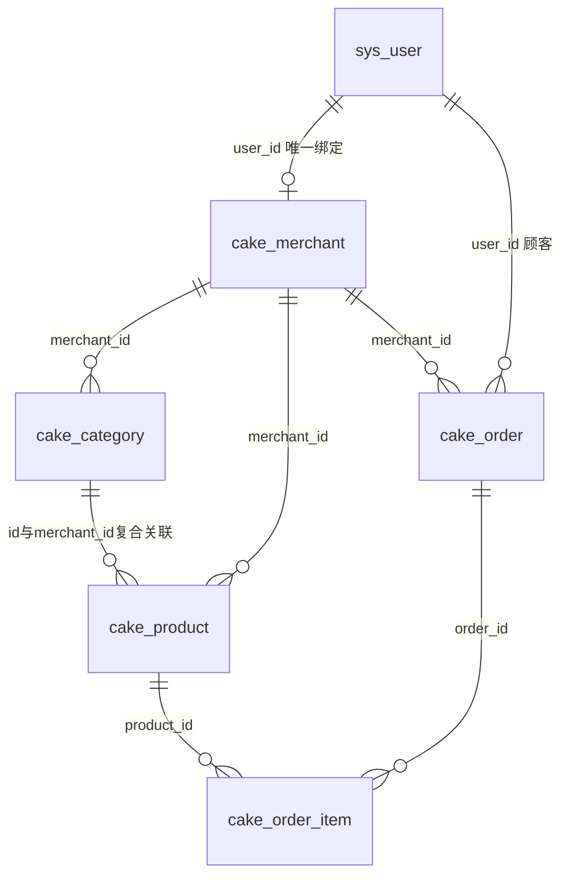

# Phase 2 数据库设计

本阶段依照原始《蛋糕店订单管理系统需求说明书_V1.1.docx》第四章建立六张核心表，不实现业务接口。执行日期为 2026-11-25，运行环境沿用 JDK 18.0.2.1、Spring Boot 3.5.16、Maven Wrapper，数据库实际服务端为 MySQL 8.0.19。详细实测结论见 [阶段报告](../../reports/PHASE_2_REPORT.md)。

## 依据与确认

需求字典 4.3、键与索引 4.4、DATA-01～09 是结构依据；Phase 0 基线完整转录仍保留。独立逐段、逐表核对当前 DOCX 与 462 个非空来源块，仅环境行存在历史差异：当前原件 JDK 18.0.2.1 / Node 24.20.0，旧转录 JDK17 / Node18。第四章无差异，原件本轮保持原样。源 DOCX 页码未重新渲染，本文件采用原文章节及表名定位。

用户本轮明确授权 Phase 2，优先于 AGENTS 与旧阶段计划中的历史阶段限制。本轮明确禁止 Entity、Mapper、Service、Controller，因此没有执行旧计划里的六实体/Mapper建设，也没有提前加入分页、认证或业务功能。`data.fieldErrors` 保持待确认。

数据库名此前未正式确认，按本轮要求使用技术命名 `cake_order_system`；专用测试库为 `cake_order_system_phase2_test`。用户于 2026-11-25 明确选择 `utf8mb4_0900_as_cs`，区分大小写和重音；这是已确认的排序规则，关闭原 collation 待确认项。仅新库和新表采用该规则，不修改服务器全局设置或其他数据库。

## 六表与关系

| 表 | 字段数 | 责任 |
| --- | ---: | --- |
| sys_user | 12 | 三角色账号、BCrypt、启停、令牌版本、失败次数和锁定 |
| cake_merchant | 9 | 一个商家账号唯一绑定一个店铺 |
| cake_category | 7 | 店内分类、排序和启停 |
| cake_product | 12 | 一条记录对应一种规格，独立价格库存 |
| cake_order | 25 | 店铺/顾客归属、幂等请求、金额、状态、联系快照和事件时间 |
| cake_order_item | 9 | 商品与规格、单价、数量、小计快照 |
| 合计 | **74** | 无额外核心表或业务字段 |

图中的账号角色约束、订单必须有 1～20 条明细由后续 Service 事务承担；外键只能保证账号/记录存在，不能把图示基数理解为数据库已保证每个 MERCHANT 必有店铺或每笔订单必有明细。

所有主键与引用 ID 保持 BIGINT UNSIGNED。后续 JSON ID 需按十进制字符串传输，Java 不可默默将完整 unsigned 范围缩为 signed long；本阶段以 JDBC 元数据和边界测试验证，不创建实体映射。

## 数据类型与历史快照

金额均为 DECIMAL(10,2)，上限 99999999.99，无 FLOAT/DOUBLE。商品价、订单金额、明细单价为正，明细数量 1～99，小计必须等于单价乘数量。数据库对输入多余小数位可能舍入，因此“SQL 能保存两位”不能替代后续应用层 BigDecimal 精确输入校验，TC-38 业务场景仍未实现。

时间均为 DATETIME(3)，create_time、update_time 初值为 CURRENT_TIMESTAMP(3)。应用连接强制会话 +08:00，避免服务器 SYSTEM 时区随主机变化影响事件值；不修改全局 time_zone。update_time 没有自动 ON UPDATE，后续合法操作应显式写数据库当前时间，终态订单不得因通用自动刷新被改写。

订单 merchant_name、receiver、phone、address 是下单快照；明细 product_name、product_spec、price、quantity、subtotal 是下单快照。后续改店名、商品资料、昵称不允许回写旧记录，历史查询不得用当前关联资料覆盖快照。本阶段没有提供历史改写接口；原始 SQL 更新权限与状态迁移不可变性仍须后续应用和受控数据库权限保障。

## DATA-01 至 DATA-09 的实现边界

| 要求 | 数据库本阶段承担 | 后续应用事务承担 |
| --- | --- | --- |
| DATA-01 | NULL、唯一、FK、29 项 CHECK、类型与范围 | 全量输入校验、非法敏感字段、错误码映射 |
| DATA-02 | 明细同商品唯一、单行小计精确关系 | 1～20条、主表金额等于明细和、建立后不可修改、终态不可写 |
| DATA-03/04 | 完整8状态的事件存在/NULL矩阵、履约分支、完成与取消互斥 | 仅允许白名单状态迁移、操作者和归属检查、并发条件更新 |
| DATA-05 | 截止=创建+30分钟、支付早于截止、事件顺序与取消时间；连接会话北京时间 | 所有写入采用数据库时间，不信客户端时间，同一创建时间计算截止 |
| DATA-06 | order_no唯一，时间字段彼此独立 | 生成订单号、碰撞重试、显式更新update_time |
| DATA-07 | 规格必填、独立商品记录、快照字段保存 | 展示/排行读取快照、来源可信、创建后不可变 |
| DATA-08 | 参数化最小种子、两账号/一店/一分类/一商品、事务提交/回滚 | 后续公开注册固定CUSTOMER、平台创建固定MERCHANT |
| DATA-09 | 归属非空及FK、商品和分类复合FK同店 | 商家账号角色MERCHANT、订单用户CUSTOMER、明细与订单同店、平台只读 |

单行 CHECK 不调用其他表、不使用触发器/存储过程，不为跨表验证增加字段或第七张表。库存回补达到 INT 上限、商家账号禁用入口、支付错误优先级等既有业务待确认项仍保留，不以本阶段约束设计替用户决定。

## 初始化与集成

首次执行顺序为建表及PK/UK → 普通索引 → FK/CHECK → 可选种子。脚本只用于首次初始化，不包含清空或删除；受控入口拒绝任何已有表/视图的目标库。MySQL DDL 隐式提交，部分失败不能宣称回滚或直接重跑，须人工核对已建对象，使用另一个明确授权的空库复现。

后端固定 MyBatis-Plus Boot3 starter 3.5.18、Connector/J 8.4.0，沿用 Boot 3.5.16，不另装 MyBatis starter。开发 SQL 日志仅记录操作事件，不输出 SQL、绑定参数或结果；生产/测试禁用 SQL 日志。凭据由进程环境或本机隐藏交互输入提供，不落入源码、命令参数或报告。详见 [初始化指南](INITIALIZATION_GUIDE.md)、[字典](DATA_DICTIONARY.md)和[索引约束](INDEX_AND_CONSTRAINTS.md)。

账号种子按用户本轮明确选择暂不执行。结构初始化完成与演示账号可登录是不同验收项；本阶段没有登录功能。
